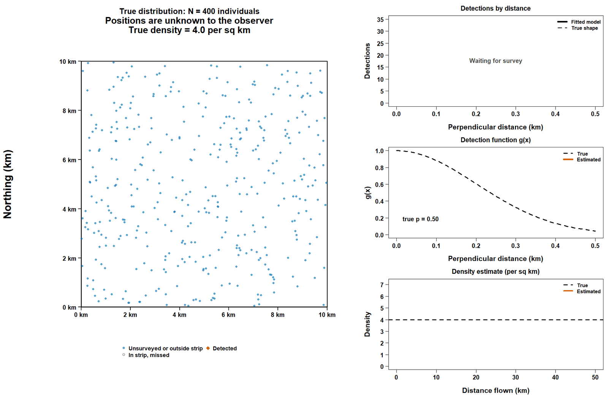



# Where we're going {.center}

## Roadmap for today

1.  Ecological state as point pattern summaries\
2.  Distance Sampling Framework
3.  Hiararchical Distance Sampling

# 1.1 Point Processes {.center}

## Point patterns

> Point patterns are the outcome of stochastic processes known as point
> processes, and statistical models describing them are called point
> process models.

-   PPMs treat both the number and the locations of discrete points as
    random quantities governed by an underlying, continuous intensity
    field.

-   The intensity is the expected number of points (e.g., animals or
    plants) per unit area in some study area and is the modeled
    parameter.

::: notes
Most ecological state variables, abundance, distribution, richness are
dervied quantities, summaries of a more fundamental quantity: point
patterns.
:::

## Point pattern and state variables

Distribution and abundance are summaries of spatial point patterns,
i.e., aggregation of a point pattern over some area.

::: notes
both distribution and abundance are simple areal summaries of spatial
point patterns for a single animal or plant species, that is,
aggregations of a point pattern over some area. To develop a basic
understanding of the relationships between a point pattern and abundance
and occurrence, we jump right in and run our first simple data
simulation in program R.

we here use simulation to explain and to understand a model, such as a
PPM.

This relationship among the three quantities is visualized in the first
three panels. Without spatial discretization, neither abundance nor
occurrence (or presence/absence) is defined; both necessarily require
discretization of continuous space into what you can think of as one or
more “sites.” In this simulation, a “site” is represented by one cell in
the entire grid. You can perhaps think of the entire grid as a region
wherein your study takes place. Only once we have established that
discretization of space is abundance (which we like to denote as N) or
occurrence (presence/absence).
:::

```{r}
#| fig-width: 8.6
#| fig-height: 6.4
#| echo: false
#--  point pattern, abundance and occurrence
# -----------------------------------------------------------------------------
# What it does:
#   1. Simulates a homogeneous Poisson point process in a square quadrat.
#   2. Discretises the quadrat into square cells and counts points per cell
#      -> ABUNDANCE (N).
#   3. Converts counts to presence/absence per cell -> OCCURRENCE (z).
#
# Reproducibility: the order of the random-number calls is identical to the
# package (rpois once, then runif for x, then runif for y), so with the same
# set.seed() you get the same M, coordinates, N, z and psi as AHMbook::sim.fn().

# -----------------------------------------------------------------------------
# Helper 1: 'histogram' of counts (non-negative integers)
# (from AHMbook:::histCount; trimmed to the single-sample case that sim.fn uses)
# -----------------------------------------------------------------------------
histCount <- function(C1, x0 = FALSE, nbmax = 30, color = "skyblue",
                      border = "white", bty = "n",
                      ylab = "Frequency", xlab = "Count", main = "") {
  rng <- range(C1)
  if (x0) rng[1] <- 0
  n.vals <- diff(rng) + 1                     # number of distinct count values
  bwidth <- if (n.vals <= nbmax) 1 else n.vals %/% nbmax + 1
  br <- seq(min(C1), max(C1) + bwidth, by = bwidth) - 0.5

  H1 <- hist(C1, breaks = br, plot = FALSE)
  plot(H1, col = color, border = border, yaxs = "i", ylim = c(0, max(H1$counts)),
       xlim = rng, bty = bty, ylab = ylab, xlab = xlab, main = main)
  axis(2)                                     # replot axis
  segments(rng[1], 0, rng[2], 0)              # line at foot of bars
}


# -----------------------------------------------------------------------------
# Helper 2: turn a plotting error into a warning instead of halting
# (from AHMbook:::tryPlotError)
# -----------------------------------------------------------------------------
tryPlotError <- function(tryError) {
  msg  <- "Plotting of output failed"
  msg2 <- attr(tryError, "condition")$message
  if (!is.null(msg2)) {
    if (msg2 == "figure margins too large")
      msg2 <- "the plotting window is too small."
    msg <- paste(msg, msg2, sep = "\n   ")
  }
  if (Sys.getenv("RSTUDIO") == "1")
    msg <- paste(msg, "Try calling 'dev.new()' before sim.fn().", sep = "\n   ")
  warning(msg, call. = FALSE)
}


# -----------------------------------------------------------------------------
# Main function
#
# quad.size : side length of the square quadrat
# cell.size : side length of the square grid cells
#             (quad.size / cell.size must be an integer)
# intensity : expected number of points per unit area
# show.plot : set FALSE to skip plotting (faster in simulation loops)
# -----------------------------------------------------------------------------
sim.fn <- function(quad.size = 10, cell.size = 1, intensity = 1, show.plot = TRUE) {

  if (abs(quad.size / cell.size - round(quad.size / cell.size)) > 1e-8)
    warning("quad.size / cell.size is not an integer; the grid will not tile the quadrat.")

  # Preliminaries
  exp.M  <- intensity * quad.size^2            # Expected population size in quadrat
  breaks <- seq(0, quad.size, cell.size)       # Boundaries of grid cells
  n.cell <- (quad.size / cell.size)^2          # Number of cells in the quadrat
  mid.pt <- breaks[-length(breaks)] + 0.5 * cell.size   # Cell mid-points

  # (1) Point pattern ----------------------------------------------------------
  M  <- rpois(1, exp.M)                        # Realized population size is Poisson
  u1 <- runif(M, 0, quad.size)                 # x coordinate of each individual
  u2 <- runif(M, 0, quad.size)                 # y coordinate of each individual

  # (2) Abundance: number of points per cell -----------------------------------
  N      <- as.matrix(table(cut(u1, breaks = breaks), cut(u2, breaks = breaks)))
  lambda <- round(mean(N), 2)                  # Average realized abundance per cell
  var.N  <- var(c(N))                          # Spatial variance of N

  # (3) Occurrence: indicator for N > 0 ----------------------------------------
  z   <- N
  z[z > 1] <- 1                                # Abundance -> presence/absence
  psi <- mean(z)                               # Realized occupancy

  # Visualisation --------------------------------------------------------------
  if (show.plot) {
    op <- par(mfrow = c(2, 2), mar = c(5, 5, 5, 2),
              cex.lab = 1.5, cex.axis = 1.3, cex.main = 1.3)
    on.exit(par(op))

    # Thick black border around the quadrat
    draw.border <- function()
      polygon(c(0, quad.size, quad.size, 0), c(0, 0, quad.size, quad.size),
              lwd = 3, col = NA, border = "black")

    # Grid lines (full-width horizontal and full-height vertical lines)
    draw.grid <- function() {
      segments(breaks, min(breaks), breaks, max(breaks))
      segments(min(breaks), breaks, max(breaks), breaks)
    }

    tryPlot <- try({

      # (1) Point pattern
      plot(u1, u2, xlab = "x coord", ylab = "y coord", cex = 1, pch = 16, asp = 1,
           main = paste("Point pattern: \nIntensity =", intensity, ", M =", M, "inds."),
           xlim = c(0, quad.size), ylim = c(0, quad.size), frame = FALSE, col = "red")
      draw.border()

      # (2) Abundance pattern: grid overlaid, N printed in each cell
      plot(u1, u2, xlab = "x coord", ylab = "y coord", cex = 1, pch = 16, asp = 1,
           main = paste("Abundance pattern: \nRealized mean density =", lambda,
                        "\nSpatial variance =", round(var.N, 2)),
           xlim = c(0, quad.size), ylim = c(0, quad.size), frame = FALSE, col = "red")
      draw.grid()
      for (i in seq_along(mid.pt)) {
        for (j in seq_along(mid.pt)) {
          text(mid.pt[i], mid.pt[j], N[i, j],
               cex = 10^(0.8 - 0.4 * log10(n.cell)), col = "blue")
        }
      }
      draw.border()

      # (3) Occurrence pattern: occupied cells (N > 0, z = 1) are hatched
      plot(u1, u2, xlab = "x coord", ylab = "y coord", cex = 1, pch = 16, asp = 1,
           main = paste("Occurrence pattern: \nRealized occupancy =", round(psi, 2)),
           xlim = c(0, quad.size), ylim = c(0, quad.size), frame = FALSE, col = "red")
      draw.grid()
      for (i in 1:(length(breaks) - 1)) {
        for (j in 1:(length(breaks) - 1)) {
          polygon(c(breaks[i], breaks[i + 1], breaks[i + 1], breaks[i]),
                  c(breaks[j], breaks[j], breaks[j + 1], breaks[j + 1]),
                  col = "black", density = z[i, j] * 100)
        }
      }
      draw.border()

      # (4) Frequency distribution of abundance across cells
      histCount(N, xlab = "Abundance (N)", ylab = "Number of cells",
                color = "grey", main = "Frequency of N with mean density (blue)")
      abline(v = lambda, lwd = 3, col = "blue", lty = 2)

    }, silent = TRUE)

    if (inherits(tryPlot, "try-error"))
      tryPlotError(tryPlot)
  }

  # Numerical output
  return(list(quad.size = quad.size, cell.size = cell.size, intensity = intensity,
              exp.N = exp.M, breaks = breaks, n.cell = n.cell, mid.pt = mid.pt,
              M = M, u1 = u1, u2 = u2, N = N, z = z, psi = psi))
}


# =============================================================================
# Your calls
# =============================================================================
# sim.fn(quad.size = 10, cell.size = 1, intensity = 1)   # random each time (no seed)

set.seed(82)
tmp <- sim.fn(quad.size = 16, cell.size = 2, intensity = 0.5)

# Inspect results
# tmp$M       # realized number of individuals in the quadrat (expected = 128)
# tmp$N       # 8 x 8 matrix of abundance per cell
# tmp$psi     # realized occupancy (proportion of occupied cells)


# =============================================================================
# OPTIONAL: check against the package (run only if AHMbook is installed)
# =============================================================================
# library(AHMbook)
# set.seed(82); a <- AHMbook::sim.fn(16, 2, 0.5, show.plot = FALSE)
# set.seed(82); b <- sim.fn(16, 2, 0.5, show.plot = FALSE)
# identical(a, b)     # should be TRUE
```

## Simulated relationships

-   abundance N: the number of points falling into each “site” (i.e.,
    cell) if there is no point in a cell, abundance is zero; if there is
    one point, abundance is one; and so on.

-   presence/absence (z): either no point in a cell (absence or
    non-occurrence) or there is at least one point in the cell (i.e.,
    presence or occurrence).

-   abundance is a first step of aggregating an underlying point pattern
    within some spatial discretization scheme, and occurrence is a
    second step in this aggregation over the spatial units.

-   occurrence is a simple information-poor summary of abundance or “the
    poor man’s abundance,” where we only keep track of two abundance
    classes.

::: notes
-   a “site” is represented by one cell in the entire grid. The entire
    grid : study area. READ THEN

Thus, the relationships between a point pattern, abundance and
occurrence are deterministic in one way onlydif you know the full
pattern and are given some spatial discretization scheme, you have full
knowledge also about abundance; and if you know the spatial pattern of
abundance, you also perfectly know the spatial pattern of occurrence. In
contrast, things are not so straightforward the other way round, e.g.,
from knowing a presence/absence pattern you cannot perfectly infer the
underlying abundance distribution, although you can make explicit
statistical inferences about abundance from simple occupancy data.

We can describe the spatial abundance pattern that emerges from this
underlying spatial point pattern by discretization of space and
summarizing the mean and the variance of the individual values ofN in
each cell. The way that this simulation works (i.e., with a uniform
intensity over the entire field), the resulting numbers N will follow a
Poisson distribution with mean lambda, where lambda is estimated by the
mean abundance (or density) over the 256 cells. In turn, the spatial
presence/absence pattern will follow a Bernoulli distribution with a
“success parameter” that we will later call “occupancy probability,” and
which corresponds to the expected proportion of occupied cells (that is,
cells with nonzero abundance).
:::

# 1.2 Population size

## Abundance

> Abundance is the number of individuals in a population at a specific
> time and location

> Density is abundance per unit area

$$\hat{D} = \frac{\hat{N}}{A}$$ $A$: sampled area

::: notes
READ THEN There are two issues on our way to density estimation and DS
is one of the well-established methods that tackles both.

First, in many cases we cannot easily convert N to D because "area
sampled" is not precisely defined.

DS tackles this issue by dividing the number of counted animals by the
surface of the transect.

Imagine a population of interest, consisting in cameleon individuals. We
detect some individuals, while some other individuals stay undetected.
It could be for example because of the vegetation, individual cameleons
were hiding during our search.
:::

# 2.1 Distance Sampling Framework

## Conventional Distance Sampling

$$\hat{D} = \frac{\sum_{s=1}^{S}n_s }{\sum_{s=1}^{S}a_s }$$

$n_s$: count at each sample unit $s$ $a_s$: surface of each sample unit
$s$

> Density is the number of counted animals divided by the surface on the
> transets

$$\hat{N} = \frac{\sum_{s=1}^{S}n_s }{\alpha}$$ $\alpha$: Proportion of
study area sampled

## Survey Geometry

-   Line Transect: Length $L$, strip half-width $W$, covered area of one
    transect $a = 2 w L$.

$$\hat{D} = \frac{\sum_{s=1}^{S}n_s }{\sum_{s=1}^{S}L_s \times 2 \times W }$$

-   Point Transect: radius $W$, covered area $a = \pi W^2$.

$$\hat{D} = \frac{\sum_{s=1}^{S}n_s }{\sum_{s=1}^{S} \pi \times W^2 }$$

-   Detection probability is assumed to be perfect.

::: notes
We can incorporate survey geometry to calculate the sampled area

For example, in a point or line transect We specify the denominator as
area of the transects length \* 2 half-width w

-   All ins in the sample area strip or circle are detected and counted
    but, animals could be missed due to imperfect detection, p is almost
    always below 1.

W contant truncation distance If W differs among units, p̂ must be
computed separately for each truncation distance and moved inside the
sum.
:::

## Imperfect detection

-   **Detection Function** $g(x)$:
    -   Probability of detecting an animal at perpendicular distance
        $x \in [0, W]$.
-   **Core CDS Assumptions**:
    1.  Animals on the line/point are detected with certainty:
        $g(0) = 1$.
    2.  Animals are detected at their initial location (no movement
        prior to detection).
    3.  Distance $x$ is measured without error.
    4.  Detections are independent events.

::: notes
Instead of assuming perfect detection, can we estimate detection
probability by recording distance of detected animals from the observer?
The longer the distance the more animals are missed?

In the case of lines the perpendicular distances to detected animals are
recorded, while in the case of points the radial distances from the
point to detected animals are recorded. A key underlying concept is that
the probability of detecting an animal decreases as its distance from
the observer increases.

perpendicular distance: shortest straight line
:::

Where do you think the detection probability shoud be in the previous
equations?

## With p\<1

$$\hat{N} = \frac{n}{\hat{p}}$$

$p$: detection probability

$$\hat{D} = \frac{\sum_{s=1}^{S}n_s }{\hat{p}\sum_{s=1}^{S}a_s }$$

::: notes
If detection probability equals 1, if we detect everybody, abundance
equals the number of individuals detected. whereas more realistically,
we only detect a fraction of individuals determined by p.

sum of the number of counted animals across sites, divided by the sum of
the sampled area multiplied by p.

where p̂ is estimated by fitting a detection function g(x; θ) to the
observed distances

Mean detection probability on the entire sampled area of surface a
:::

## Example survey

{fig-align="center"}

::: notes
The true population is drawn first, as 400 animals in a 10 × 10 km
square, uniform by default.

Five parallel transects appear, and an aircraft flies them one after
another with a turn leg between each. Animals change as the aircraft
passes: Detected animals become vermilion diamonds with a line showing
their perpendicular distance. Animals missed inside the strip become
open grey circles. Everything else stays blue.

Top right: A histogram of detection distances builds up, with the fitted
detection function scaled to the counts and the true shape dashed.

Middle right: The estimated detection function g(x) is shown against the
true one, with the effective half-width shaded and p̂ printed next to the
true p.

Bottom right: A running density estimate, D̂ = n / (2 · effort · μ̂),
converges on the true density.

Animation of an aerial line-transect survey. An aircraft flies parallel
lines over 400 animals; animals seen turn orange diamonds. A histogram
of detections by distance builds up, showing detections fall off with
distance, and the estimated density converges on the true value of 4 per
square kilometre.
:::

## Popularity

-   Distance sampling methods are performed with one sample occasion
    (visit) and no individual identification.

-   Distance sampling models provide reliable estimates of density and
    abundance if DS assumptions are met.

## Activity

**Format**: Form 3 groups

**Materials**: 1 set of histograms showing counts of animals against
distance and 6 field stories per group

**Your task**: Match each histogram to one of the field stories.

# 2.2 Hierarchical Distance Sampling

## Model structure: part 1

-   Observation Submodel:

$$y_{ij} \sim Bernoulli(p_{ij} \times z_i)$$

$$p_{ij} = 1 − exp(−h_{ij})$$

$$\text{h}_{ij}=\exp(p_0)\exp\!\big(-d_{ij}^2/(2\sigma^2)\big),\qquad p_{ij}=1-\exp(-\text{h}_{ij})$$

## Model structure: part 2

-   Ecological Submodel:

$$u_i \sim Uniform (S)$$

$u_i$: spatial locations of individuals\
$S$: the state-space of the point process\
$N$: the number of points in $S$, i.e., the population size exposed to
sampling.

$${D} = \frac{N}{A(S)}$$
$$z_i\sim\text{Bernoulli}(\psi),\quad i=1,\dots,M;\qquad N=\sum_{i=1}^{M}z_i$$

::: notes
point process models underlie all distance sampling models, and so we
provide here just a brief review of some of this fundamental unifying
model before describing variations of the observation process.

The individuals’ locations form a random point pattern in a region

The most basic point process model posits that spatial locations of
individuals, u, are uniformly distributed in some region, S, called the
state-space of the point process

The state-space S must be defined in order for population size to be
also defined. For example, in CDS, the state-space is usually defined by
a rectangular region, which encloses the transect extending out to some
truncation distance. The number of points in the state-space is the
population size, N, exposed to sampling, and density is population size
divided by the area of the state-space
:::

## Data augmentation

> Augment dataset with all-zero detection histories up to
> superpopulation $M$.

Latent indicator $z_i \sim \text{Bernoulli}(\psi)$.
$$z_i\sim\text{Bernoulli}(\psi),\quad i=1,\dots,M;\qquad N=\sum_{i=1}^{M}z_i\sim\text{Binomial}(M,\psi),\quad \psi\sim\text{Uniform}(0,1)$$

::: notes
In the standard formulation we specify a prior distribution for total
population size by introducing a set of Bernoulli indicator variables
and assuming
:::

## Activity overview

**Format**: Groups of 3\
**Material**: 1. Rules card: one per student (3 per group).

2.  Spotted-houses sheet: one per group.

3.  Haunted Roster: one per group. Each group's random numbers are
    different.

4.  Pumpkin Patch table for $M$ = r M: one per group.

5.  Group scoreboard: one per group.

6.  Three role name tags per group: *Ghost Hunter*, *Candy Counter*,
    *Pumpkin Keeper*.

On Halloween night, a trick-or-treat survey team walked down Hollow Lane
and wrote down every house where they spotted a lit jack-o'-lantern (a
candy house). Houses set far back from the sidewalk are easy to miss.
The team spotted n candy houses. How many candy houses are really on
Hollow Lane?

::: notes
"Our survey team spotted n candy houses. We know they missed some,
because houses set back from the sidewalk are hard to see. Last week
we'd just divide: n divided by p. That works for simple problems. But
many models describe **each house** separately: where it is, how big its
jack-o'-lantern is, whether it was spotted. To write that kind of model,
we need one row per real house. And we don't know how many real houses
there are. So we don't even know how big our data sheet should be.
Tonight we're going to fix that with ghosts." **Likely question:** "Why
not just divide by $\bar p$?" *Answer:* For this simple case you can,
and the answers will agree (Step 5 shows it). DA matters for more
complex models where there is no simple formula.
:::

**Key idea.** In a hierarchical model, $N$ sets the number of rows (and
the number of hidden distances). Standard MCMC software needs a fixed
number of unknowns. DA fixes the number of rows.

## Activity

**Your task**: Each group keeps a Haunted Roster: the n houses they
spotted plus extra "ghost" rows. Round by round, they decide which ghost
rows are real houses they walked past (treat) and which are just ghosts
(trick). The number of real houses changes each round, and those numbers
become the answer.

Step1: Assign roles.

*Ghost Hunter*: reads the round's numbers aloud if the group wants help
keeping pace, and checks that everyone writes in the correct round's
column.

*Candy Counter*: adds the 1s, works out $N$, and calls $N$ out to
Mahdieh.

*Pumpkin Keeper*: rolls the die and reads the Pumpkin Patch table.

All three students check their own block of ghost rows every round.

Note in roster: rows 1 to n are spotted houses (always real); rows n + 1
to M are ghost rows that might be real houses we walked past, or might
be nothing.

## Activity

**Your task**: Each group keeps a Haunted Roster: the n houses they
spotted plus extra "ghost" rows. Round by round, they decide which ghost
rows are real houses they walked past (treat) and which are just ghosts
(trick). The number of real houses changes each round, and those numbers
become the answer.

Step2:

For each round, the groups follow these steps.

All students: Check your block of ghost rows against the current T.
Write 1 or 0 in this round's column.

Each student: Tell the Candy Counter how many 1s you wrote.

Candy Counter: Compute $N$ = n + total 1s. Write it on the scoreboard
and call it out.

Instructor: Write each group's $N$ on the class candy board.

Pumpkin Keeper: Use the dice and the Pumpkin Patch table to get the new
$\psi$ and next T. Write them on the scoreboard.

Once every group has its next T, call the next round.

::: notes
"Instead of guessing the number of rows, we make the sheet **too long on
purpose**: M rows. The first n are houses we spotted. The rest are ghost
rows: rows where nobody saw anything. Some ghost rows are real candy
houses we walked right past. Those are **treats**. Others are just
ghosts with no house at all. Those are **tricks**. Every row secretly
has a label: 1 for treat, 0 for trick. Count the 1s, and that's how many
candy houses there are."

**The model behind the game.** For each row $i = 1, \dots, M$:

$$z_i \sim \text{Bernoulli}(\psi), \qquad y_i \mid z_i \sim \text{Bernoulli}(z_i\,\bar p), \qquad N = \sum_{i=1}^{M} z_i.$$

The haunting rate $\psi$ is the chance that any row is a real house. A
flat prior on $\psi$ gives a flat prior on $N$ from 0 to $M$, so the
ghosts do not add information. They only give $N$ room to vary.
:::

## Practice row

Spotted houses are easy: a ghost can't hand out candy, so anything we
spotted is real. For a ghost row, ask: we didn't spot anything here, so
what's the chance it's still a real house? There are two ways to see
nothing: it's a real house we walked past, or it's just a ghost.

$$P(\text{treat} \mid \text{not spotted}) = \frac{\psi \times (1 - \hat p)}{\psi \times (1 - \hat p) + (1 - \psi)}$$

## Summary

1.  **What:** Add extra all-zero "ghost" rows to the data, so there are
    $M$ rows. Each row gets a hidden label $z$: treat (1) or trick (0).

2.  **Why:** It makes the data set a fixed size, so models where $N$ is
    unknown can be fitted with standard software.

3.  **How:** Repeat two steps: label ghost rows given $\psi$, then
    update $\psi$ given the labels. $N = \sum z$ each round, and all the
    $N$ values together form the posterior.

4.  **Check:** $N$ must stay well away from $M$.

**What we simplified.** We held $\hat p$ fixed. A full analysis also
estimates the detection function from the setback distances and treats
each missed house's distance as unknown. The same two steps are still at
the heart of it. Below is the mode definition:

```         
model {
  psi   ~ dunif(0, 1)                 # haunting rate; flat prior on N from 0 to M
  sigma ~ dunif(0, 100)               # detection function scale
  for (i in 1:M) {
    z[i] ~ dbern(psi)                 # treat (1) or trick (0)
    x[i] ~ dunif(0, B)                # setback distance: known if spotted
    p[i] <- exp(-x[i] * x[i] / (2 * sigma * sigma))
    mu[i] <- z[i] * p[i]              # a ghost can never be spotted
    y[i] ~ dbern(mu[i])               # 1 = spotted house, 0 = ghost row
  }
  N <- sum(z[])                       # the candy count
}
```

**Where DA is used in practice.** Models with individual covariates
(such as group size), spatial capture–recapture, open-population models,
and integrated models.

::: notes
1.  It fixes the size of the data set when the number of individuals is
    unknown, so the model can be fitted with standard methods.

2.  Ghosts can never be spotted, so a spotted house must be real. A row
    with no sighting could be a missed house or a ghost.

3.  $N$ piled up at or near `M_small`, and $\psi$ was close to 1.
:::
